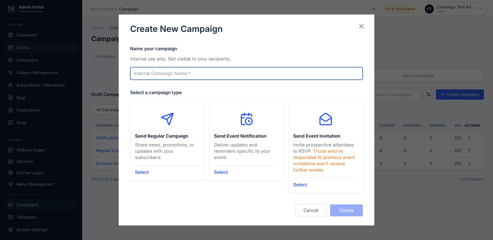

# Campaign workspace implementation

Implemented locally on 14 October 2026 (Africa/Lusaka), using the privately retained Glue Up reference and [implementation plan](event-campaigns-implementation-plan.md). The account-specific reference document and screenshots remain local and are excluded from the public GitHub repository; implementation screenshots below contain disposable test data only.

The local application is available at **http://localhost:5175/admin/campaigns**. The API runs on port 4002. The original release was deployed through Coolify from GitHub `main` as commit `4d484f3`; live provider delivery has not been performed by this implementation work.

### SMTP delivery — 27 October 2026

Campaigns now send through the SMTP account in **Admin → Settings → Email**, the same one used for account, ticket and receipt emails. Resend is no longer used: its API key, webhook and `RESEND_*` variables are gone, and the Resend steps under "Live deployment settings" below no longer apply.

- **Sender Settings → Campaign delivery** shows the SMTP server, a switch for sending to real recipients (off by default) and an hourly limit (200 by default). Both are stored in the new `campaign_delivery_settings` table, created empty at startup.
- **Check senders** signs in to the SMTP server and marks a sender verified when its email uses the SMTP login's domain or the From domain in Admin Settings.
- The worker spreads sends across the hour and stops at the hourly limit, counted from recipients sent in the last 60 minutes.
- Opens come from a 1×1 tracking image (`/api/email/open`), clicks from the existing link redirects. Delivery and later bounce emails are not reported by SMTP, so the report shows Sent, Opened, Clicked and Not opened.
- A send interrupted mid-transfer is marked unconfirmed and never retried automatically. The report lets an admin choose **It was sent** or **Send it again**. Failures the server clearly refused (4xx, connection or login errors before the message) retry on their own.
- Verification: 37 focused tests and all 34 MySQL integration checks pass; a local SMTP test server received the test email and a five-recipient live send.

### Production collation correction — 14 October 2026

Production's imported `users`, `events` and `event_registrations` tables use `utf8mb4_general_ci`, while the campaign tables use MySQL 8's `utf8mb4_0900_ai_ci`. Campaign listing joins and the attendee subscription query compared those columns implicitly, producing MySQL error 1267 throughout the shared campaign workspace. The local checks originally used one collation for all tables and missed this production difference.

The correction explicitly collates the campaign reference operands at the five joins/comparisons with imported tables. It does not rewrite customer records, change table collations, reset subscriptions or change mail settings. See [MySQL's collation precedence rules](https://dev.mysql.com/doc/refman/8.4/en/charset-collation-coercibility.html).

The maintained MySQL integration fixture now preserves the same mixed collations as production. It failed with the exact reported error before the correction; all **35 MySQL checks** and **32 focused tests** pass afterward. The corrected API identifies itself as `2026-10-14-campaign-collation-fix` at `/api/health`.

The main local API was restarted and its health/version and additive migration were verified. Its existing database still contains zero events/campaigns and six seeded templates. Test campaigns, contacts, surveys and credentials were confined to disposable databases, which were removed after verification.

## Implemented coverage

- **Creation:** the three campaign cards, internal name and exact helper text, selection state, orange invitation notice, event selection for event types, and an event-free Regular Campaign.
- **Lists:** Draft/Scheduled/Sent tabs, search, type/event filters, pagination, configurable columns, preview/mobile preview, editor/report routing, duplication, and recoverable draft deletion.
- **Navigation:** Dashboard, Campaigns, Surveys, Subscription Lists, Suppression Lists, Contacts, Templates, and Sender Settings.
- **Wizard:** Recipients → Settings → Template → Content & Design → Review & Send for Regular Campaigns; four steps without Template for event campaigns. Draft changes save on progression. Delivery states lock editing. Unsaved draft navigation has a confirmation; unchanged rich-text editors stay clean.
- **Audience:** include/exclude unions, deduplication, unique-recipient and source counts, saved contact lists, committees, subscriptions, active members, membership types, members within committees, smart lists, organization staff, event invitee responses, registration statuses, ticket types, and advanced registration/date/attendance filters.
- **Directory:** account and attendee synchronization, manual contacts, CSV import/export, assistant addresses, group membership management, membership dates/status, private/public subscription lists, active-member restrictions, automatic enrollment with recorded consent, and archive/restore.
- **Settings:** internal name, English language, subject, preview text, sender identity, reply-to, comma-separated CC, and per-recipient assistant copies. Sender verification comes from the provider domain API.
- **Templates/editor:** reusable template administration, saving a campaign as a template, gallery, Empty/Left Side Bar/Right Side Bar/Custom HTML layouts, HTML import, draggable/reorderable elements, nested columns, rich-text formatting, merge tags, image library/upload, logo size/alignment, global colors/fonts/button/article styles, browser preview, and mobile preview.
- **Event content:** event header/summary/tracker/registration (including independently selected Event Trackers in regular newsletters), speaker selection, editable sponsors/exhibitors, surveys, social links, and existing event resources. Protected resources retain individual access grants; private virtual joining details are limited to confirmed paid/free registrations. Legacy GrapesJS projects retain their stored layout/content/styles and visual canvas.
- **Invitations:** event-scoped invitees, signed links, “I Will Attend” and “No”, explicit response submission, response history, suppression across later invitations, and a separate link to ordinary registration/payment.
- **Execution:** review checklist, test-email endpoint, final confirmation, Date/Time/IANA timezone scheduling stored in UTC, due-time audience freezing, pause/resume/cancel, and return-to-draft only before provider acceptance or ambiguous dispatch.
- **Delivery protection:** immutable revisions, optimistic draft versions, one durable send request, atomic job claims, paced provider requests, stable provider payload/idempotency keys, bounded transient retries, consent/list-membership/cancellation/RSVP checks at dispatch, and preserved ambiguous acceptance. Disabling delivery preserves queued work and due schedules.
- **Reports:** sent/delivered/opened/not opened/clicked/opened-but-not-clicked/bounced/ignored/failed/excluded statuses, recipient details and membership flags, search/filtering/pagination/columns/export, per-link total/unique clicks, dashboard periods, and bounce/unsubscribe reasons/date filters/exports.
- **Provider events:** signed, timestamp-checked webhooks; duplicate suppression; replay of events received before the provider message was associated with its recipient; provider-log reconciliation that verifies recipient, campaign tag, subject and exact saved HTML before recording acceptance.
- **Preferences:** signed public subscription preferences, per-list opt-out/re-subscription, optional unsubscribe reason/details, global promotional unsubscribe and one-click headers. List selection never silently clears an unsubscribe.
- **Mobile integration:** authenticated Expo token registration/removal, recipient-scoped push jobs, deduplication, provider tickets/receipts and unavailable-device deactivation. The scheduling option stays disabled until the mobile integration is configured.
- **Permissions:** campaign viewing, editing and sending remain separate; sender changes require settings access. Existing account/ticket/certificate/receipt SMTP configuration remains in place.

## Verification

- Production frontend build passed.
- Scoped campaign lint passed after the form-control fixes. Linting all modified files additionally reports six existing errors in `server/index.js` and `src/layouts/AdminLayout.jsx`; the same six reproduce in the clean `HEAD` checkout.
- **32 focused automated tests passed.** They cover the campaign state/eligibility/resource contracts, timezone/DST handling, merge escaping, nested layouts, styles, legacy canvas content, footer presence, provider ambiguity/conflicts, webhook signatures and CSV formula protection.
- **34 real MySQL integration checks passed** in disposable databases copied from table structures only. They exercise migrations twice, directory/audience rules, subscriptions, stale edits, send idempotency, concurrent claims, CC, history preservation, link statistics, provider events, duplication/archive, schedules and pause/resume, disabled delivery, automatic enrollment of account-backed attendees, late opt-outs/RSVPs, unknown acceptance, retry stability/expiry, surveys, mobile receipts, reconciliation, early webhook replay, private virtual joining details, multiple-booking identity and independent Event Trackers. Provider sending is mocked; no customer email or push is sent.
- Browser verification used a separate database and ordinary administrator sign-in. Regular campaign creation, settings/design save/reload, image selection, mobile preview, event creation requirements, four-step notification flow, schedule confirmation, pause/resume, survey response/results, RSVP and subscription persistence were exercised.
- The final newsletter Event Tracker selection rendered correctly in the browser. The native template-name prompt interrupted automated browser control before template submission could be confirmed; template storage and compilation were verified separately. This interaction is not counted as a completed browser test.
- Authenticated image upload, database persistence and hosted retrieval passed against the actual local HTTP API. The image was the project's existing public Mutale logo. Browser image-library selection and saved rendering also passed. Automated file-chooser selection itself was blocked by the Chrome extension's file-URL permission; extension permissions were left unchanged.
- Phone viewport **390 × 844**: the campaign workspace rendered with `documentWidth = viewportWidth = 390`. Email mobile preview used a 375-pixel frame.
- The full repository run produced **613 passed / 39 failed**. The same 39 failures reproduced in a clean `HEAD` checkout across the unchanged receipt-PDF, receipt-page, event-session, date-dependent registration/event-service and browser-storage tests. These baseline failures are separate from the passing campaign checks.

Commands:

```sh
npm run build
npm test -- server/__tests__/emailCommunications.test.js shared/campaignWorkspace.test.js server/__tests__/campaignProvider.test.js shared/emailCampaign.test.js shared/emailDesignCompile.test.js src/components/admin/campaigns/grapesCampaignPlugin.test.js
node server/scripts/test-campaign-workspace.mjs
```

The integration command creates and drops its own `mutale_campaign_test_*` database. It requires a local database user allowed to create disposable databases. Do not point it at production. `CAMPAIGN_TEST_KEEP=1` is an optional local browser-fixture mode; its randomly generated sign-in data is written only to a temporary file, not this repository.

## Local browser evidence

These screenshots show isolated test data and, for scheduling, mocked sender verification with the outbox worker disabled.

- [Three campaign cards](campaign-implementation/01-create-campaign.jpg)
- [Review and missing-provider safeguards](campaign-implementation/02-review-send.jpg)
- [Recorded RSVP](campaign-implementation/03-invitation-response.jpg)
- [Date/time/timezone schedule dialog](campaign-implementation/04-schedule-dialog.jpg)
- [Resumed future schedule](campaign-implementation/05-scheduled-campaign.jpg)
- [Saved image and mobile email preview](campaign-implementation/06-mobile-email-preview.jpg)
- [Phone workspace](campaign-implementation/07-phone-workspace.jpg)



## Live deployment settings and remaining verification

Before enabling live delivery in the intended environment:

1. Back up the database, deploy matching frontend/backend/shared files, and run the additive startup migration. Keep campaigns paused during a version rollback; retain the added columns/tables and sent history.
2. Set the public HTTPS `APP_URL`, stable `AUTH_TOKEN_SECRET`, `RESEND_API_KEY`, and `RESEND_WEBHOOK_SECRET` through deployment secrets. None of these secrets belongs in documentation or client-side code.
3. Configure Resend webhook delivery to `/api/email/webhooks/resend`, and use **Sender Settings → Check Verification** to verify the actual sending domain. Domain checks and reconciliation require a key with the necessary read access.
4. Perform an explicitly authorized test delivery, verify delivered/opened/clicked/bounced events and public RSVP/preference/resource links, then enable `RESEND_LIVE_SENDS=1` for the approved launch.
5. `CAMPAIGN_OUTBOX_WORKER_ENABLED` defaults to enabled. Set it to `0` for a paused deployment or a browser-test instance. Review interrupted provider acceptance in reports; do not resend an unknown message merely because it timed out.
   Provider requests include an explicit User-Agent. Sending defaults to two requests per second per API process; `RESEND_REQUESTS_PER_SECOND` can adjust pacing to the provider account's limit (maximum ten here). The worker processes up to 32 jobs per tick. Coordinate pacing across multiple API replicas, since the provider's limit applies across the team's API keys. See [Resend's API requirements](https://resend.com/docs/api-reference/introduction).
6. Mobile push additionally needs an actual Mutale mobile application registering Expo tokens, push credentials and `EXPO_ACCESS_TOKEN`. MyGlue itself is Glue Up's application and is not presented as a Mutale integration.
7. Verify the deployed browser flow, resource persistence and existing SMTP ticket/receipt/certificate paths independently. Local verification does not establish production delivery.

## Deliberate adaptations and observed limits

- Mutale branding and the established 600-pixel email shell are used. Glue Up branding and Biomedical Society of Zambia contact/member data are not imported.
- English was the observed language. Additional translations are not claimed.
- The invitation draft editor was not available during the Glue Up inspection. Its four-step implementation is a documented design choice, consistent with the observed notification flow; its RSVP controls and suppression behavior are implemented and tested.
- Audience labels resolve actual Mutale records. A status such as `waitlisted` without matching registrations produces an empty audience; this campaign work does not introduce a separate event waitlist admission workflow.
- Consent and unsubscribe eligibility remain explicit. Attending an event, joining a committee or creating an account does not itself grant promotional permission.
- Bounce categories use the observed UI labels, recognized provider messages and an “Other” fallback; raw provider details are retained. Glue Up's private classification rules are not represented as known.
- Email opens and clicks remain estimates because privacy protection and automated scanners can affect them.
- Existing legacy schedules should be reviewed during production rollout where the old system did not persist the intended wall time. New schedules persist both the wall time/timezone and UTC instant.
